<p align="center">
  
</p>

<p align="center">
  <a href="https://www.linkedin.com/in/naga-rajan-m"></a>
  <a href="mailto:nagarajanmmarisamy@gmail.com"></a>
  
</p>

---

## 👋 About me

I'm a **B.Tech Information Technology** student at **KPR Institute of Engineering and Technology**, Coimbatore (2026 – 2029), who arrived from a **Diploma in Electronics and Communication Engineering** (CGPA 8.75/10).

That mix is my edge. I started with circuits, sensors and microcontrollers, and now I write software that protects things. I like projects where hardware thinking and security thinking meet, where a bug is not just a crash but a door someone can walk through.

- 🔐 Building **secure software**: hashing, access control, audit logs, attack prevention
- 🔌 Comfortable down at the **hardware layer**: ESP32, PCB design, sensors
- 🏪 Running **NAGA MOBILES**, my family phone shop, so I know what real users and real deadlines look like
- 🎯 Placement Coordinator and ECE Association Treasurer in my diploma years

```python
class Nagarajan:
    studying  = "B.Tech Information Technology"
    background = "Electronics & Communication"
    focus     = ["Secure software", "Cybersecurity", "IoT / Embedded"]
    learning  = ["AWS", "Networking", "Databases"]
    motto     = "Build it useful. Then build it safe."
```

---

## 🛠️ Tech stack

**Languages**


**Security**


**Data, cloud and networking**


**Tools**


**Embedded and hardware**


---

## 🚀 Featured projects

### 🗜️ [ArchiveGuard](https://github.com/Nagarajan-Marisamy/ArchiveGuard) · *Python* · Oct – Nov 2026
A security tool that stops **ZIP Slip** path traversal and **ZIP Bomb** attacks before an archive is ever extracted, built on the Python standard library alone.
- Enforces hard limits: **100:1** compression ratio, **500 MB** uncompressed size, **10,000** files
- Warns about hidden files and dangerous extensions
- Ships with both a **CLI** and a **Tkinter GUI**, and exports **JSON audit reports**

### 🛡️ [Security Management System](https://github.com/Nagarajan-Marisamy/Security-Management-System) · *Java* · Aug – Sep 2026
A console application with secure login, **role-based access control** (`ADMIN`, `OFFICER`, `USER`) and account management.
- **Salted PBKDF2** password hashing
- **Audit logging** of logins and admin actions
- Multithreaded, with **deadlock prevention** through a consistent lock order

### 💓 IoT-Based Wearable Health Monitoring System · *ESP32 · C* · Jan – Mar 2026
A Li-ion powered wearable that tracks **heart rate in real time** with an ESP32 and a MAX30102 sensor.
- Streams live data to a **ThingSpeak** dashboard
- Companion web interface deployed on **Vercel**

---

## 🏅 Certifications

| Certification | Issuer | Date |
|---|---|---|
| ISO/IEC 27701:2025 Lead Auditor | Mastermind | Jun 2026 (valid to Jun 2029) |
| Introduction to Cybersecurity | Cisco Networking Academy | Oct 2026 |
| Getting Started with Cisco Packet Tracer | Cisco Networking Academy | Oct 2026 |
| AWS Foundations: Machine Learning Basics | Amazon Web Services | Oct 2026 |
| Agentic AI Foundations: Course Introduction | Amazon Web Services | Oct 2026 |
| Introduction to the AWS Cloud Adoption Framework | Amazon Web Services | Oct 2026 |
| MongoDB Basics for Students | MongoDB | Aug 2026 |
| PCB Design | Zeekers Technology Solutions | Aug 2025 |
| Deloitte Australia: Cyber Job Simulation | Forage | Jun 2025 |

---

## 🌱 Currently

- 📚 Second-year B.Tech IT, going deeper into Java, data structures and databases
- ☁️ Building up AWS and networking fundamentals
- 🔎 Looking for an **internship** where I can work on secure, practical software

---

## 📫 Let's connect

I'm happy to talk about security tooling, embedded projects or internship opportunities.

**[LinkedIn](https://www.linkedin.com/in/naga-rajan-m)** · **[Email](mailto:nagarajanmmarisamy@gmail.com)** · **[GitHub](https://github.com/Nagarajan-Marisamy)**

<p align="center">
  <sub>Built with Java, Python and a lot of coffee in Coimbatore ☕</sub>
</p>
